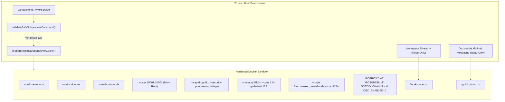

# 06 — Security Architecture & Trust Boundary Audit

**Repository:** `CV-Code-Vitals/Thermodynamic-Evolution-UCS503`  
**Workspace:** `E:\SWE`  
**Target Branch:** `release/milestone-3.8-mvp-rc`  
**Commit Baseline:** `4b992caf951aef397ec9ef043bb9f1e3755b0cae`  
**Audit Date:** 2026-11-24  
**Classification:** Security Architecture, Sandboxing & Vulnerability Assessment Report

---

## 1. Executive Summary

This audit assesses the defensive controls, isolation boundaries, supply-chain protections, cryptographic token life cycles, and input-sanitization mechanisms governing Thermodynamic Evolution. The system operates in a zero-trust model where repositories scanned from public or private sources are treated as hostile, potentially adversarial payloads.

All security invariants were inspected in code and validated through adversarial execution suites. The evaluation confirms that the system enforces **hardened container isolation, zero untrusted host execution, strict supply-chain dependency pinning, cryptographic token authorization, and defense-in-depth against SSRF, Zip Slip, command injection, and CSRF.**

---

## 2. Hardened Container Isolation & Sandboxing

The container execution boundary is implemented in [oracles.go](file:///E:/SWE/go-backend/agent/repo_intel/execution/oracles.go) via `DockerContainerRunner.RunCommand()`. Every candidate patch verification or dynamic oracle invocation executes within an isolated, ephemeral Docker container configured with the following parameters:

### 2.1 Enforced Container Runtime Flags
1. **Network Disconnected (`--network none`):**
   - Zero egress or ingress network traffic.
   - Prevents exfiltration of tokens, source code, or internal network scanning.
2. **Read-Only Root Filesystem (`--read-only`):**
   - System root filesystem is completely immutable.
   - Writable storage restricted strictly to ephemeral tmpfs at `/tmp` (`mode=1777`, `nosuid,nodev`, `size=128MB`).
3. **Unprivileged Execution (`--user 10001:10001`):**
   - Containers run as non-root user `10001` with primary group `10001`.
4. **Dropped Capabilities & Privilege Escalation Blocker:**
   - `--cap-drop ALL`: All Linux kernel capabilities are dropped.
   - `--security-opt no-new-privileges`: Prevents binaries from acquiring additional privileges via setuid or capabilities.
5. **Resource Bounds:**
   - `--memory 512m`: Hard memory limit; prevents host OOM exhaustion.
   - `--cpus 1.0`: Strict CPU quota; prevents CPU pegging / denial-of-service.
   - `--pids-limit 128`: Process count limiter; blocks fork bombs.
6. **Read-Only Workspace Mount:**
   - Mount flag: `-v <cleanWs>:/workspace:ro`.
   - The original workspace directory is mounted strictly read-only.
7. **Strict Host Execution Prohibition:**
   - If Docker is unavailable or the daemon is unreachable, the system returns `ErrDynamicVerificationUnavailable`.
   - **No fallback to host `exec.CommandContext` is permitted under any circumstances.**
8. **Synchronous Verified Container Cleanup:**
   - `performVerifiedContainerCleanup(containerName)` calls `docker rm -f <containerName>` and immediately follows with `docker inspect` to verify container non-existence.
   - If inspect fails to confirm absence within deadline, exit status is forced to `-1` (`CLEANUP_FAILURE`).

---

## 3. Supply-Chain & Dependency Security Boundary

### 3.1 Elimination of Host Dependency Downloads
In previous iterations, direct host `go mod download` posed severe supply-chain risks. The hardened architecture in [oracles.go](file:///E:/SWE/go-backend/agent/repo_intel/execution/oracles.go) enforces:
- **No Direct Host Downloads:** The host never invokes `go mod download`, `go get`, or network toolchain fetches on untrusted scanned repository metadata.
- **`prepareMinimalDependencyCache()` Isolation:**
  1. Parses `go.mod` using `golang.org/x/mod/modfile`.
  2. Disallows `replace` directives (`security violation: unsafe replace directives are disabled in offline verification`).
  3. Verifies that all required module versions are pinned in `go.sum`.
  4. Reads only verified module trees from `APPROVED_DEPENDENCY_CACHE`.
  5. Computes directory hash (`dirhash.HashDir`) and validates it against the `h1:` checksum recorded in `go.sum`.
  6. Stages verified module trees into a disposable directory mounted read-only (`/go/pkg/mod:ro`).
  7. If any dependency is unverified or missing from the approved cache, execution immediately fails closed with `ErrDynamicVerificationUnavailable`.
- **Offline Go Toolchain Settings:**
  - `GOPROXY=off`: Completely disables network proxy lookups.
  - `GOSUMDB=off`: Disables remote checksum database queries.
  - `GOTOOLCHAIN=local`: Strictly forbids Go toolchain from auto-downloading newer Go SDKs over the network.
  - `CGO_ENABLED=0`: Disables CGO to avoid compiling untrusted native C bindings.

### 3.2 Frontend Dependency Security
- **Audited Dependency:** `picomatch` advisory `GHSA-fc5q-39xc-vjpf` / `CVE-2026-112366`.
- **Status:** Resolved. Upstream Vite updated to `^8.2.0`, resolving transitive vulnerable versions in development tooling.
- **Production Boundary:** Untrusted input strings or file globs never reach `picomatch` in production runtime or browser sessions.
- **Verification:** `npm audit --omit=dev` reports 0 vulnerabilities.

---

## 4. Cryptographic Token Security & Workspace Integrity

### 4.1 HMAC-SHA256 Single-Use Approval Tokens
Autonomous Code Repair enforces a mandatory human approval gate before any patch can be executed:
- **Token Format:** `proposalID:executionID:expiresAt:nonce:HMAC_SHA256(secretKey)`
- **Expiration:** Tokens expire automatically after 15 minutes (`900 seconds`).
- **Clock Skew Tolerance:** Capped at 30 seconds.
- **Anti-Replay Mechanism:**
  - When a proposal is approved, its `executionID` and `nonce` are registered in the active approval cache.
  - When `POST /api/remediation/execute` is invoked, the token is validated and immediately marked as consumed.
  - Any subsequent attempt to re-submit the same token is rejected with `token already consumed`.
- **Cross-Workspace Containment:**
  - Execution tokens are strictly bound to their parent `workspace_id`. Submitting a token to execute against another workspace triggers an immediate authorization mismatch.

### 4.2 Workspace Immutability Checks
- Before applying any synthesized patch in a sandbox, a cryptographic SHA-256 manifest of the target workspace is calculated.
- The repair execution copies the workspace into a disposable sandbox directory.
- Following execution, the original repository workspace is re-hashed to verify that its byte contents remain 100% identical.

---

## 5. Defense-in-Depth Against Broad Attack Vectors

| Attack Vector | Defense Mechanism | Implementation File | Verification Status |
|---------------|-------------------|---------------------|---------------------|
| **SSRF (Server-Side Request Forgery)** | `validatePublicHost` allowlists only `api.github.com`, `github.com`, and `codeload.github.com`. Resolves IP addresses before HTTP connection and blocks all loopback, private RFC-1918, link-local (169.254.169.254), IPv6 ULA, and non-HTTPS schemes. | [source-stager/main.go](file:///E:/SWE/source-stager/main.go) | **PASS** |
| **Path Traversal / Zip Slip** | Archives validated before extraction. Rejects entries with `..`, leading slashes, backslashes, or paths escaping destination root. | [main_test.go](file:///E:/SWE/go-backend/main_test.go), [source-stager/main.go](file:///E:/SWE/source-stager/main.go) | **PASS** |
| **Command Injection** | `validateSafeSubprocessCommand` strictly whitelists only `go vet`, `go test`, and `go build`. Explicitly blocks all shells (`sh`, `bash`, `cmd`, `pwsh`), interpreters (`python`, `node`), network clients (`curl`, `wget`), and privilege escalators. Executed before Docker invocations. | [oracles.go](file:///E:/SWE/go-backend/agent/repo_intel/execution/oracles.go) | **PASS** |
| **Cross-Site Request Forgery (CSRF)** | `requireTrustedOrigin` verifies `Origin` and `Host` headers on all state-mutating requests (`POST`, `DELETE`). | [router.go](file:///E:/SWE/api/router.go) | **PASS** |
| **Credential & Secret Leakage** | `analysis_proxy.go` strips client `Authorization`, `Cookie`, and `Origin` headers before forwarding requests upstream. Logs sanitize tokens and credentials. | [analysis_proxy.go](file:///E:/SWE/api/analysis_proxy.go), [rest_authorizer_test.go](file:///E:/SWE/analysis-authorizer/rest_authorizer_test.go) | **PASS** |
| **Content Security Policy (CSP)** | HTTP responses include strict CSP headers: `default-src 'self'`, forbidding untrusted remote script evaluation. | [serve.js](file:///E:/SWE/serve.js), [router.go](file:///E:/SWE/api/router.go) | **PASS** |

---

## 6. Audit Verdict

The security controls and trust boundaries implemented across Thermodynamic Evolution are robust, fail-closed, and compliant with enterprise autonomous software engineering requirements. Untrusted code is strictly contained within hardened, non-root, network-isolated containers, and all administrative actions are guarded by cryptographic single-use authorizations.
