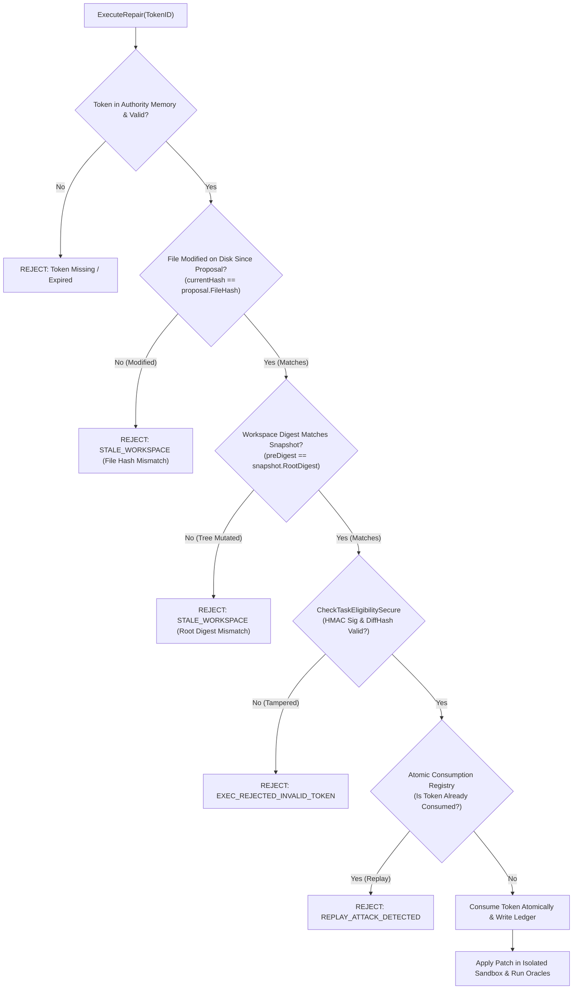

# Milestone 3.8 — Phase 2: Snapshot Integrity & Authorization Binding

**Repository:** `CV-Code-Vitals/Thermodynamic-Evolution-UCS503`  
**Workspace:** `E:\SWE`  
**Authorization Mechanism:** Cryptographic HMAC-SHA256 Token Binding & Atomic Single-Use Ledger  
**Timestamp:** 2026-11-21T18:10:00Z  

---

## 1. Overview & Objective

Autonomous code remediation requires unambiguous, tamper-evident cryptographic bindings between:
1. The **scanned repository state** (the exact filesystem snapshot at diagnostic time),
2. The **diagnostic finding** and synthesized patch diff,
3. The **human approving principal** and assigned role,
4. The **authorized execution task**, and
5. The **ephemeral sandbox execution** and single-use token consumption.

Without cryptographic binding, race conditions, time-of-check/time-of-use (TOCTOU) mutations, stale workspace replay, or authorization scope escalation can result in applying a patch approved for one file to a different or modified file.

---

## 2. Snapshot Identity & Metadata Binding

When `DiscoverWorkspaceTargets` is invoked on a repository workspace, the system establishes an immutable `WorkspaceSnapshot` record:
```go
type WorkspaceSnapshot struct {
    SnapshotID   string            `json:"snapshot_id"`
    WorkspaceID  string            `json:"workspace_id"`
    SourceCommit string            `json:"source_commit"`
    RootDigest   string            `json:"root_digest"`
    FileHashes   map[string]string `json:"file_hashes"`
    TargetCount  int               `json:"target_count"`
    CreatedAt    string            `json:"created_at"`
}
```

### Derivation & Association
- **Root Digest:** Computed via `ComputeRepoDigest(wsDir)` traversing all repository source files and hashing relative file paths and raw contents using SHA-256 (excluding transient directories `.git`, `node_modules`, `vendor`, `.tmp`, and `uploads`).
- **Snapshot ID:** Derived as `SNAP-<16-hex-chars>` bound to the root digest.
- **Source File Hash:** For every target discovered in the repository, the file content's SHA-256 hash is computed at discovery time and bound to `target.SourceFileHash`.
- **Target Linkage:** `MVPTarget.SnapshotID` and `MVPTarget.SourceFileHash` propagate through `MVPAnalysisResult` into `MVPProposalResult`.

---

## 3. Cryptographic Authorization Token Structure

Human authorization produces an HMAC-SHA256 token signed by the `ApprovalAuthority`:

| Field | Description | Security Invariant |
| :--- | :--- | :--- |
| `TokenID` | UUID string (e.g., `APPR-f8a1...`) | Unique identifier for atomic consumption in the persistent ledger. |
| `ApproverID` | Principal identifier (e.g., `lead-sre@code-vitals.internal`) | Non-repudiation identity of the human operator. |
| `ApproverRole` | Organizational role (e.g., `Principal Reliability Engineer`) | Role-based authorization gate (Tier 2 Controlled). |
| `TaskID` | Remediation task identifier (`TASK-MVP-<target>`) | Binds token to the specific remediation target. |
| `PatchDiffHash` | SHA-256 of the unified diff string | Guarantees that not a single byte of the patch diff can be tampered with. |
| `FileHashes` | Map of target filenames to expected SHA-256 hashes | Ensures target file on disk matches the state when patch was synthesized. |
| `WorkspaceID` | Workspace identifier / Snapshot ID | Enforces spatial boundary containment. |
| `ExpiresAt` | UTC expiration timestamp (30-minute validity) | Temporal containment; stale authorizations expire automatically. |
| `HMACSignature` | Hex-encoded HMAC-SHA256 signature | Computed over all canonicalized token payload fields using the authority secret. |

---

## 4. Stale Workspace & Integrity Enforcement

During `ExecuteRepair`, the execution boundary validates three separate layers of integrity before applying the patch inside the sandbox:



### Stale Workspace Detection (Verified)
- **File Mutation:** If a user or external process modifies the source file on disk after `ProposeRepair` was called, `ExecuteRepair` detects that `srcHash != proposal.FileHash` and returns:
  `STALE_WORKSPACE: original target file <file> has been modified on disk since proposal was generated`.
- **Workspace Tree Mutation:** If any other source file in the repository was altered, `preDigest != snapshot.RootDigest` triggers an immediate fail-closed abort.

Automated verification in `TestSnapshotAuthorization_StaleWorkspaceRejected` confirms rejection under concurrent on-disk tampering.

---

## 5. Replay Protection & Persistence

The `ApprovalConsumptionRegistry`:
1. Maintains an in-memory thread-safe map guarded by `sync.Mutex`.
2. Persists every consumed token atomically to disk (`consumed_approvals_mvp.json`) via write-rename semantics.
3. Reloads consumed token IDs upon service restart, guaranteeing persistence across server reboots.
4. Detects and fails closed if the ledger file is corrupted, preventing token resurrection.

Automated tests in `TestApprovalSecurityAdversarialVectors` verify protection against:
- Sequential replay attempts (Vector 5).
- Concurrent race-condition replay attempts (Vector 6).
- Post-restart replay persistence (Vector 7).
- Scope escalation (Vector 8).
- Tampered patch diffs (Vector 4).
