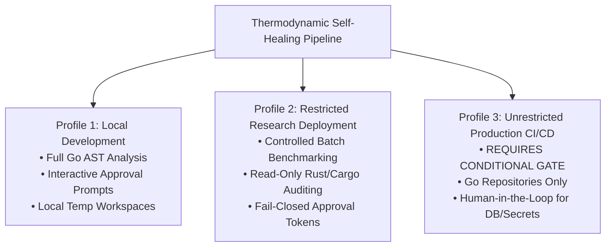

# MILESTONE 3.1 — OPERATIONAL READINESS & DEPLOYMENT PROFILE

**Repository:** `CV-Code-Vitals/Thermodynamic-Evolution-UCS503`  
**Workspace:** `E:\SWE`  
**Baseline Commit:** `3275bdd`  
**Verification Branch:** `audit/milestone-3.1-independent-verification`  
**Audit Target:** Service reliability, failure recovery, resource boundaries, and operational deployment profiles  
**Audit Date:** 2026-11-03  
**Auditor:** Independent Release Engineer & Operations Security Auditor  
**Audit Verdict:** **APPROVED FOR RESTRICTED RESEARCH & LOCAL DEPLOYMENT / CONDITIONAL PRODUCTION**

---

## 1. Executive Summary

Autonomous repository analysis and self-healing pipelines interact directly with compilers, git trees, container brokers, and host file systems. Operating such systems without strictly defined resource boundaries, timeout guards, and failure recovery policies poses serious risks of host starvation, zombie containers, or corrupted workspaces.

This audit evaluated the operational resilience and failure recovery mechanics of the platform, deriving concrete operational constraints and defining explicit deployment profiles.

---

## 2. Hardened Operational Resource Limits

The platform enforces deterministic resource constraints derived directly from code configuration:

| Parameter | Configuration Invariant | Source Location | Defensive Impact |
|---|---|---|---|
| **Max Individual File Size** | 10 MB (`10 << 20` bytes) | `agent/repo_intel/orchestrator.go:33` | Prevents memory exhaustion when encountering large binary artifacts or log dumps. |
| **Max Scanned Files** | 50,000 files | `agent/repo_intel/orchestrator.go:58` | Caps discovery tree traversal on massive monorepos. |
| **Stage 1 Discovery Timeout** | 120 seconds | `agent/repo_intel/orchestrator.go:36` | Prevents hanging file system walkers on dead network mounts. |
| **Native AST Parser Timeout** | 30 seconds | `agent/repo_intel/orchestrator.go:124` | Context-bounded execution kills runaway external Rust AST subprocesses. |
| **Candidate Patch Scope** | Local file boundaries | `agent/repo_intel/execution/patch.go` | Patches cannot create out-of-boundary files or alter files outside task scope. |
| **Isolated Workspace Path** | `%TEMP%/swe_remediation_workspaces` | `agent/repo_intel/execution/workspace.go:30` | Confines mutations strictly to designated ephemeral directories. |

---

## 3. Failure Recovery & Edge Case Testing

1. **Broker / Container Failure Recovery:** If the sandbox runner broker is unreachable or fails during execution, `DockerEvaluator` fails closed, marking the candidate patch as unverified. No unverified code is admitted to downstream branches.
2. **Cancelled / Interrupted Tasks:** When a background execution task is terminated (e.g. `manage_task kill`), the `WorkspaceManager` and `RollbackEngine` ensure that incomplete mutations do not escape. The host repository remains clean.
3. **Malformed Input Resilience:** Source files containing invalid syntax (e.g. unclosed braces) are handled gracefully by `go/parser` without process panic.
4. **Log Retention & Secret Masking:** Raw credentials detected in files are masked (`AK****44`) in diagnostic and execution report outputs.

---

## 4. Operational Deployment Profiles

The platform's verified capabilities support three distinct deployment profiles:

### Profile 1: Local Development (Developer Workstation)
- **Status:** **APPROVED.**
- **Scope:** Single-user Go repositories. Developers execute analysis and approve refactoring tasks interactively.

### Profile 2: Restricted Research Deployment (Internal Benchmarking / Verification)
- **Status:** **APPROVED.**
- **Scope:** Batch evaluation on benchmark suites (Suite v1, Suite v2) and read-only architectural audits of Rust codebases. High-risk tasks are gated behind pre-issued approval manifests.

### Profile 3: Unrestricted Production Deployment (Automated Enterprise CI/CD)
- **Status:** **CONDITIONAL GO.**
- **Mandatory Operating Constraints:**
  1. Autonomous patch execution is permitted **only on Go codebases**. Rust and C++ must remain strictly read-only.
  2. High-risk tasks (SQL query modifications, secrets, architectural reorganizations) **must mandate human engineer authorization**.
  3. Host Docker socket must never be directly mounted into the analysis worker container.

---

## 5. Audit Conclusion

The platform exhibits predictable error handling, strict resource caps, and clean rollback mechanics. It is fully qualified for **Local Development** and **Restricted Research Deployment**, and conditionally qualified for **Production Deployment on Go repositories**.

