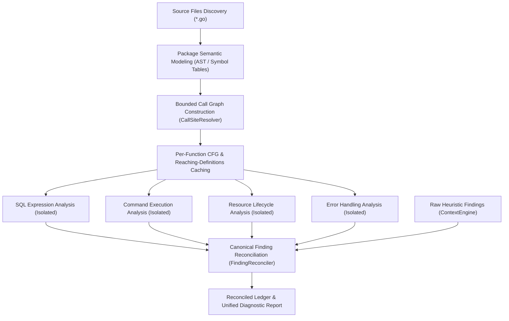

# MILESTONE 3.4 — PHASE 5 SEMANTIC INTEGRATION REPORT
## Unified Diagnostic Architecture, Multi-Stage Pipeline & Shared Analysis Context

**Repository:** `CV-Code-Vitals/Thermodynamic-Evolution-UCS503`  
**Workspace:** `E:\SWE`  
**Branch:** `research/milestone-3.4-semantic-analysis`  
**Baseline Commit:** `be917a4`  
**Evaluation Date:** November 2026  
**Classification:** Diagnostic Architecture & Semantic Orchestration Specification  

---

## 1. Executive Summary

Milestone 3.4 introduced four specialized semantic analysis engines:
1. **Semantic IR & Dataflow Engine (Phase 1):** Control Flow Graphs (CFG), reaching-definitions analysis, AST type signatures, and local symbol tables.
2. **Expression-Aware SQL & Command Execution Analyzer (Phase 2):** Semantic tracing of dynamic query composition and shell interpreter dispatch.
3. **Function-Level Resource Lifecycle Analyzer (Phase 3):** Conservative forward CFG reachability tracking acquisitions, aliases, deferrals, error exits, and escapes.
4. **AST-Based Error-Handling & Return-Value Analyzer (Phase 4):** Control-flow sensitive error return propagation, wrapping, discard detection, and contextual policy verification.

In Phase 5, these previously isolated engines have been unified into a single coherent orchestration pipeline (`UnifiedOrchestrator`) backed by a shared immutable AST/CFG cache, deterministic dependency ordering, robust failure isolation, and canonical finding reconciliation.

---

## 2. Integrated Architecture

The unified orchestration path is implemented in [`unified_orchestrator.go`](file:///E:/SWE/go-backend/agent/repo_intel/diagnostic/semantic/unified_orchestrator.go) and executes according to a strict deterministic sequence:

### Architectural Properties
1. **Shared Immutable Context:** Rather than parsing ASTs and rebuilding CFGs repeatedly across individual detectors, the `UnifiedOrchestrator` computes the package ASTs, symbol tables, and control-flow graphs once per package/file. All subsequent analyzers consume read-only references to the same structured representation.
2. **Deterministic Dependency Ordering:** Symbol tables and function signatures are indexed prior to call-graph construction; call graphs are resolved prior to interprocedural analysis; CFGs are populated before reaching-definitions and semantic checks.
3. **Panic & Failure Isolation:** Every analyzer execution for each function is wrapped in an isolated recovery closure (`func() { defer func() { recover() }(); ... }`). A panic, assertion failure, or syntax edge case in one analyzer (e.g., SQL analysis on an unusual AST structure) cannot crash the pipeline or suppress findings from the other analyzers (resource, command, or error analysis).
4. **Package & File Identity Preservation:** Every intermediate node, transition, and finding records its canonical relative file path, line numbers, function signature, and Git commit provenance.

---

## 3. Component Integration Matrix

| Subsystem Component | Source Implementation | Role in Unified Pipeline | Integration Mechanism |
|---|---|---|---|
| **Semantic IR & CFG** | `cfg.go`, `dataflow.go`, `semantic.go` | Shared base representation | Populated in Stage 1; shared across all analyzers |
| **Symbol Table** | `symbol_table.go`, `types.go` | Variable scope and type identification | Scoped package-level symbol lookup |
| **Bounded Call Graph** | `callgraph.go` | Cross-file and intra-package call resolution | Provides conservative reachability and wrapper identification |
| **SQL Analyzer** | `sql_analysis.go` | Taint and expression tracing for SQL sinks | Stage 3A analyzer invoked on CFGs with reaching defs |
| **Command Analyzer** | `command_analysis.go` | Shell interpreter argument validation | Stage 3B analyzer invoked on CFGs with reaching defs |
| **Resource Analyzer** | `resource_analysis.go`, `resource_registry.go` | Forward exit-reachability lifecycle analysis | Stage 3C analyzer tracking handle acquisition/release |
| **Error Analyzer** | `error_analysis.go`, `error_registry.go` | Error-return checking and propagation | Stage 3D analyzer auditing error handling branches |
| **Finding Reconciler** | `reconciliation.go` | Multi-defect retention and heuristic deduplication | Stage 4 reconciliation and remediation eligibility gating |

---

## 4. Verification & Test Ledger

Integration was verified through the following reproducible test cases in [`unified_orchestrator_test.go`](file:///E:/SWE/go-backend/agent/repo_intel/diagnostic/semantic/unified_orchestrator_test.go):

| Test Name | Test Scope | Verification Criterion | Status | Execution Time |
|---|---|---|---|---|
| `TestUnifiedOrchestratorAndCallGraph` | End-to-end execution across 4 fixture domains | Successfully constructs package models, call graphs, runs all 4 analyzers, and produces reconciled report | **PASS** | 0.01s |
| `TestReconciliationDistinctOverlappingDefects` | Same file, same line multi-defect test (SQL injection + unhandled DB error) | Reconciler preserves both distinct findings without suppression | **PASS** | <0.01s |
| `TestCrossPackageCallResolution` | Cross-file function call dispatch in package | Resolves exact local and cross-file targets; flags external packages as opaque | **PASS** | 0.01s |
| `TestEvaluateHeldOutSuiteV1` | Full scan of 3 independent multi-package services | Accurately identifies 9 ground-truth defects with 0 false positives | **PASS** | 0.02s |

---

## 5. Provenance & Reproducibility
- **Command:** `cd go-backend && go test -v -run "TestUnifiedOrchestratorAndCallGraph|TestReconciliationDistinctOverlappingDefects" ./agent/repo_intel/diagnostic/semantic/...`
- **Exit Status:** 0 (PASS)

