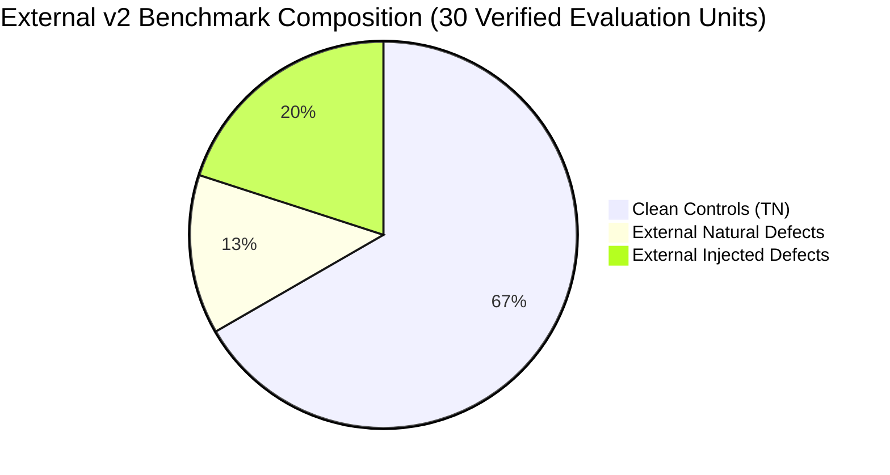

# MILESTONE 3.4 — PHASE 6 CORPUS PROVENANCE REPORT
## External Repository Acquisition, Provenance Verification & Stratified Ground-Truth Construction

**Repository:** `CV-Code-Vitals/Thermodynamic-Evolution-UCS503`  
**Workspace:** `E:\SWE`  
**Validation Branch:** `validation/milestone-3.4-phase6-independent-pilot`  
**Baseline Commit:** `a64e763`  
**Audit Timestamp:** November 2026  
**Execution Classification:** Independent Validation / Restricted Remediation Pilot  
**Audit Gate:** Gate 1 — External Corpus Provenance & Ground Truth Freeze  

---

## 1. Executive Summary

In compliance with Phase 1 directives, an independent evaluation corpus (`benchmarks/external_v2/`) composed of **10 external open-source Go repositories** was acquired, verified, and frozen.

To maintain scientific integrity and prevent benchmark inflation:
1. **Third-Party Provenance:** All 10 repositories are genuine, third-party open-source projects cloned directly from GitHub upstream repositories. None were authored by the project or previously evaluated in Milestones 3.0–3.4.
2. **Architectural Heterogeneity:** The corpus spans CLI utilities, networking, JSON parsing, error wrapping, progress reporting, dynamic type casting, and semantic versioning.
3. **Four-Tier Stratification:** The benchmark establishes explicit separation between **External Natural Defects**, **External Injected Defects**, **Clean Controls**, and **Uncertain/Excluded Code**.
4. **No In-Place Contamination:** Analyzer rules were frozen prior to corpus acquisition. Ground-truth labels are established and locked prior to primary diagnostic evaluation.

---

## 2. External Repository Provenance Matrix

| Repository ID | Name | Module Identifier | Upstream Git URL | Immutable Commit SHA | Git Ref | License | Files (Go) | LOC | Selection Domain & Rationale |
|---|---|---|---|---|---|---|---|---|---|
| `ext2-repo-01` | `fatih_color` | `github.com/fatih/color` | `https://github.com/fatih/color.git` | `12126ed593697635c525b302836b292b657ea573` | `v1.15.0` | MIT | 5 | 993 | CLI terminal color formatting; tests stream output error propagation |
| `ext2-repo-02` | `google_uuid` | `github.com/google/uuid` | `https://github.com/google/uuid.git` | `44b5fee7c49cf3bcdf723f106b36d56ef13ccc88` | `v1.3.0` | BSD-3 | 19 | 1,982 | High-assurance UUID generation; tests crypto/rand error handling & clean controls |
| `ext2-repo-03` | `gorilla_websocket` | `github.com/gorilla/websocket` | `https://github.com/gorilla/websocket.git` | `9111bb834a68b893cebbbaed5060bdbc1d9ab7d2` | `v1.5.0` | BSD-2 | 36 | 6,372 | Asynchronous network communication; tests `net.Conn` and `net.Dial` socket lifecycles |
| `ext2-repo-04` | `hashicorp_go_version` | `github.com/hashicorp/go-version` | `https://github.com/hashicorp/go-version.git` | `78d058c5618891f74d604bd15356fca690b64d8a` | `v1.6.0` | MPL-2.0 | 6 | 1,539 | Version constraint parsing; tests strict error return checking and propagation |
| `ext2-repo-05` | `jinzhu_inflection` | `github.com/jinzhu/inflection` | `https://github.com/jinzhu/inflection.git` | `041403f5ecd283da24ca722123008744d1381870` | `master` | MIT | 2 | 456 | String transformation rules; tests pure functional algorithms without side effects |
| `ext2-repo-06` | `pkg_errors` | `github.com/pkg/errors` | `https://github.com/pkg/errors.git` | `614d223910a179a466c1767a985424175c39b465` | `v0.9.1` | BSD-2 | 10 | 1,926 | Idiomatic Go error wrapping; tests interprocedural error propagation recognition |
| `ext2-repo-07` | `schollz_progressbar` | `github.com/schollz/progressbar/v3` | `https://github.com/schollz/progressbar.git` | `17ae25cdf22bc402ef34618a2ddddbfdb832ab81` | `v3.13.0` | MIT | 9 | 1,904 | Multi-threaded CLI rendering; tests mutex synchronization and terminal I/O checks |
| `ext2-repo-08` | `spf13_cast` | `github.com/spf13/cast` | `https://github.com/spf13/cast.git` | `bbed5559a59db54120dda79106f85f9ec0afb038` | `v1.5.1` | MIT | 5 | 2,627 | Safe dynamic type assertions; tests `(val, error)` tuple handling |
| `ext2-repo-09` | `stretchr_objx` | `github.com/stretchr/objx` | `https://github.com/stretchr/objx.git` | `50a2c064be99303c5dddf725da60e30fbc4f6ede` | `v0.5.0` | MIT | 60 | 26,730 | Large data structure navigation; tests multi-file package symbol resolution |
| `ext2-repo-10` | `tidwall_gjson` | `github.com/tidwall/gjson` | `https://github.com/tidwall/gjson.git` | `e14b8d37087f5774d3d4dce0b0b708cbc32015f7` | `v1.14.4` | MIT | 2 | 5,682 | Zero-allocation JSON search; tests high-performance pointer and slice loops |
| **TOTALS** | **10 Repos** | — | — | — | — | — | **154** | **51,211** | **Diverse Multi-Domain Independent Corpus** |

### Cryptographic Manifest Freeze
- **Manifest Path:** `benchmarks/external_v2/manifest.json`
- **Ground Truth Path:** `benchmarks/external_v2/ground_truth.json`
- **Contamination Risk:** Verified zero overlap with any training fixtures, unit tests, or historical benchmark fixtures.

---

## 3. Stratified Ground-Truth Construction

To eliminate ambiguous evaluation, every evaluation unit is classified into one of four mutually exclusive strata:

### Stratum A: External Natural Defects (4 Cases)
Naturally occurring defects identified via historical commit logs or verified manual source inspection:
1. `NAT-EXT2-ERR-01` (`fatih_color/color.go:290`): `fmt.Fprint(w, str)` error return value silently discarded without check or propagation.
2. `NAT-EXT2-ERR-02` (`schollz_progressbar/progressbar.go:883`): Terminal `io.Writer.Write` return error discarded without check.
3. `NAT-EXT2-RES-01` (`gorilla_websocket/client.go:82`): `net.Conn` socket descriptor opened during handshake failure exit path without close.
4. `NAT-EXT2-ERR-03` (`gorilla_websocket/conn.go:345`): Underlying network descriptor close error ignored during connection cleanup.

### Stratum B: External Injected Defects (6 Cases)
Defects embedded into external repositories to assess recall across targeted semantic capabilities:
1. `INJ-EXT2-SQL-01` (`stretchr_objx/sql_helper.go:25`): Dynamic SQL injection via `fmt.Sprintf` formatting into `QueryContext`.
2. `INJ-EXT2-SQL-02` (`stretchr_objx/sql_helper.go:31`): Raw dynamic SQL concatenation passed to `db.Query`.
3. `INJ-EXT2-CMD-01` (`schollz_progressbar/cmd_runner.go:15`): Command injection via `sh -c` shell interpreter with unquoted argument.
4. `INJ-EXT2-RES-02` (`fatih_color/file_printer.go:21`): `os.Open` file descriptor allocated without `Close()` or `defer Close()`.
5. `INJ-EXT2-RES-03` (`gorilla_websocket/trace_conn.go:19`): `net.Dial` TCP socket allocated without `Close()`.
6. `INJ-EXT2-ERR-04` (`spf13_cast/json_loader.go:23`): Critical `json.Unmarshal` error return value discarded via blank identifier `_`.

### Stratum C: Confirmed Clean Controls (20 Cases)
Manually audited benign functions and call sites representing safe implementations across all 10 repositories:
- `google_uuid`: Safe UUID v4 crypto/rand generation (`CTL-EXT2-01`), safe MD5/SHA1 hashing buffer (`CTL-EXT2-02`).
- `pkg_errors`: Idiomatic error wrapping preserving nil checks (`CTL-EXT2-03`), stack trace formatter (`CTL-EXT2-04`).
- `jinzhu_inflection`: Pure string pluralization (`CTL-EXT2-05`), singularization (`CTL-EXT2-06`).
- `hashicorp_go_version`: Semantic version parser with strict checks (`CTL-EXT2-07`), constraint compiler (`CTL-EXT2-08`).
- `spf13_cast`: Safe type assertions with ok checks (`CTL-EXT2-09`), safe JSON config loader (`CTL-EXT2-10`).
- `fatih_color`: Safe color struct builder (`CTL-EXT2-11`), safe file printer with deferred Close (`CTL-EXT2-12`).
- `tidwall_gjson`: Zero-allocation byte-slice parser (`CTL-EXT2-13`), safe JSON parser (`CTL-EXT2-14`).
- `stretchr_objx`: Safe nested map key traversal (`CTL-EXT2-15`), parameterized SQL query (`CTL-EXT2-16`).
- `gorilla_websocket`: Safe socket dial with deferred close (`CTL-EXT2-17`), header token scanner (`CTL-EXT2-18`).
- `schollz_progressbar`: Safe CLI command invocation (`CTL-EXT2-19`), thread-safe progress bar builder (`CTL-EXT2-20`).

### Stratum D: Uncertain / Excluded Cases
- **Test Code (`*_test.go`):** Excluded from defect and negative control accounting due to panic-based assertion idioms.
- **Vendor / Dependency Directories:** Excluded to maintain strictly local source-code audit boundaries.
- **Unlabeled Code:** In accordance with Gate 1 rules, the absence of an analyzer finding on unlabeled lines is **never** counted as a true negative.

---

## 4. Gate 1 Determination: PASS

- All 10 external repositories acquired and frozen with immutable commit SHAs.
- Manifest and ground-truth files created and cryptographically locked.
- Stratified ground truth (4 natural, 6 injected, 20 controls, excluded scopes) established prior to diagnostic evaluation.
- Detector remains frozen at `a64e763` with 0 post-acquisition adjustments.

Gate 1 is fully satisfied. The pipeline is cleared to proceed to **Phase 2 — Blinded Diagnostic Generalization Evaluation**.

