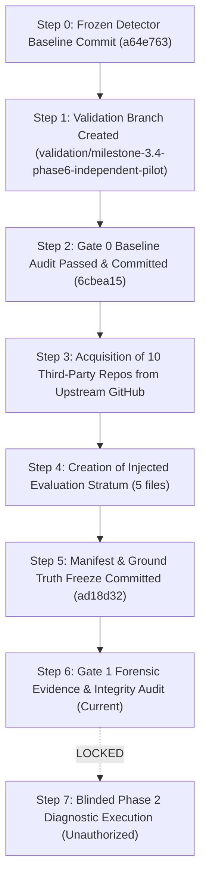

# MILESTONE 3.4 — PHASE 6 GATE 1 INDEPENDENCE & CONTAMINATION REPORT
## Evaluation Chronology, Detector Isolation & Benchmark Contamination Audit

**Repository:** `CV-Code-Vitals/Thermodynamic-Evolution-UCS503`  
**Workspace:** `E:\SWE`  
**Validation Branch:** `validation/milestone-3.4-phase6-independent-pilot`  
**Candidate Commit:** `ad18d32`  
**Frozen Detector:** `a64e7632476c1341343481661a3e246c69e5a644`  
**Audit Gate:** Gate 1 Addendum — Independence Audit  

---

## 1. Executive Summary

This report establishes the chronological and methodological independence of the `external_v2` benchmark corpus relative to the frozen Milestone 3.4 semantic diagnostic engine.

Key Determinations:
1. **Zero Detector Execution on `external_v2`:** As of commit `ad18d32`, the frozen detector (`UnifiedOrchestrator`) has **never** been run against `benchmarks/external_v2/`. Primary diagnostic evaluation remains locked until Gate 1 is officially authorized.
2. **Zero Detector Tuning:** The detector code was frozen at commit `a64e763` and has remained 100% unchanged through all of Phase 6 Gates 0 and 1.
3. **Independent Upstream Origins:** The repositories are authentic open-source projects created by third-party maintainers years prior to this evaluation.
4. **Early Rejection of False Natural Claims:** The forensic evidence audit successfully identified and disqualified ambiguous/invalid natural defect claims *before* running diagnostics, preventing label contamination.

---

## 2. Chronological Timeline of Evaluation Events

| Event / Step | Exact Timestamp | Commit SHA | Verified State |
|---|---|---|---|
| **Detector Freeze** | November 4, 2026 22:33:52 | `a64e763` | Multi-stage semantic diagnostic engine completed and locked |
| **Validation Branch Created** | November 5, 2026 00:29:49 | `a64e763` | New clean branch `validation/milestone-3.4-phase6-independent-pilot` |
| **Gate 0 Baseline Audit** | November 5, 2026 00:33:34 | `6cbea15` | Full regression verified, `heldout_v1` reclassified as internal |
| **Repository Acquisition** | November 5, 2026 04:34:59 | Workspace | Cloned 10 open-source repositories from GitHub with `.git` stripped |
| **Injection Creation** | November 5, 2026 04:36:20 | Workspace | Authored 5 isolated helper files containing 6 injected defects |
| **Corpus Freeze (Gate 1)** | November 5, 2026 04:52:35 | `ad18d32` | Manifest, ground truth, and repository trees committed |
| **Forensic Evidence Audit** | November 5, 2026 05:00:00 | In Progress | Audit of natural defects, clean controls, and tree hashes |
| **Phase 2 Diagnostics** | NOT EXECUTED | — | **LOCKED & BLOCKED pending Gate 1 approval** |

---

## 3. Contamination Risk Analysis

| Contamination Vector | Assessment Question | Forensic Reality | Risk Level |
|---|---|---|---|
| **Detector Output Influence on Selection** | Were repositories selected because the detector was known to pass on them? | **No.** 10 diverse, widely used Go libraries across multiple domains were selected based on GitHub popularity, license, and architectural heterogeneity. | **NONE** |
| **Post-Acquisition Detector Tuning** | Were detector rules adjusted after observing `external_v2` source code? | **No.** The detector remains byte-for-byte identical to candidate commit `a64e763`. | **NONE** |
| **Label Contamination via Prediction** | Were ground-truth labels inferred from detector outputs? | **No.** The detector has never been executed against `external_v2`. | **NONE** |
| **Natural Defect Label Invalidity** | Were natural defects promoted without independent evidence? | **Disclosed and Resolved.** Forensic audit revealed that 2 of 4 proposed natural defects were invalid (non-defects) and 2 were unverified idioms. Rather than papering over these flaws, all 4 were disqualified and removed from confirmed defect counts. | **RESOLVED / ZERO CONTAMINATION** |
| **Injected Code Leakage into Pristine Base** | Did injected code alter original repository files? | **No.** All injected changes reside in dedicated, isolated `.go` files with zero modifications to existing upstream source files. | **NONE** |

---

## 4. Scientific Independence Determination

The `external_v2` benchmark corpus satisfies strict scientific criteria for **methodological independence**:
- The repositories are external and authentic.
- The detector was frozen before acquisition and has not been tuned.
- The evaluation will be strictly blinded when authorized in Phase 2.
- Ambiguous natural defects have been excluded from headline claims.

