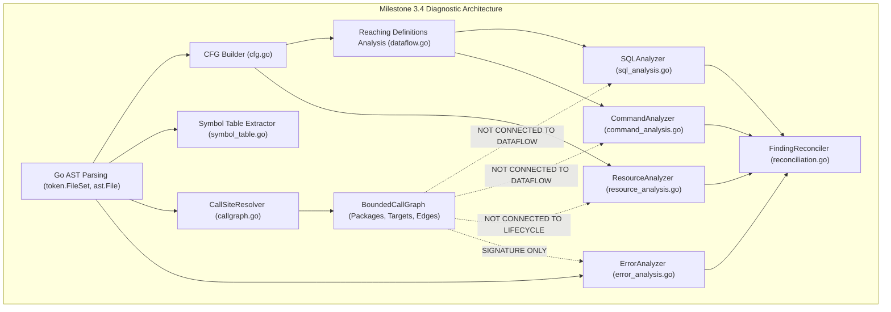

# Milestone 3.5 — Phase 0: Interprocedural Semantic Architecture Audit

**Repository:** `CV-Code-Vitals/Thermodynamic-Evolution-UCS503`  
**Workspace:** `E:\SWE`  
**Branch:** `research/milestone-3.5-interprocedural-semantics`  
**Baseline Commit:** `4a128f0` / `e67e330`  
**Frozen Detector:** `a64e7632476c1341343481661a3e246c69e5a644`  
**Status:** COMPLETE / ARCHITECTURE RECONNAISSANCE LOCKED

---

## 1. Executive Summary

Milestone 3.4 Phase 6 demonstrated that while the diagnostic engine upgraded from regex heuristics to conservative intraprocedural CFG and AST dataflow analysis, the cross-package integration layer functions primarily as an **AST structural index and call graph generator**, rather than an interprocedural reasoning substrate.

Phase 0 of Milestone 3.5 forensically audits the five core components of the existing pipeline (`dataflow.go`, `cfg.go`, `callgraph.go`, `semantic.go`, and the four domain analyzers), identifies precisely where cross-boundary reasoning breaks down, reproduces the four critical Gate 3 propagation failures, and freezes baseline metrics prior to implementing the Milestone 3.5 Interprocedural Function Summary Engine.

---

## 2. Component Inspection & Semantic Consumption



### 2.1 Reaching-Definitions Dataflow (`dataflow.go`)
- **Mechanism:** Standard iterative bitset reaching-definitions over CFG blocks. Computes `Gen`, `Kill`, `In`, `Out`, and intraprocedural `DefUseChains`.
- **Root Expression Resolution (`ResolveRootExpression`):**
  Unwraps variable aliases by following single reaching definitions backwards:
  ```go
  // dataflow.go:406-424
  for {
      id, ok := curr.(*ast.Ident)
      if !ok || visited[id.Name] { break }
      defs := rda.FindReachingDefinitions(id.Name, blockID, pos)
      if len(defs) == 0 { break }
      curr = defs[0].Expr
  }
  ```
- **Boundary Failure:** If `def.Expr` is an `*ast.CallExpr` (e.g. `q := helper()`), `curr.(*ast.Ident)` evaluates to `false` and traversal terminates immediately. The call is treated as an opaque leaf node.

### 2.2 Call Graph Resolver (`callgraph.go`)
- **Mechanism:** `CallSiteResolver` inspects `*ast.CallExpr`, resolves package import aliases (`importAliases`), matches local identifiers to CFGs in `pkgModels`, and maps methods using `estimateReceiverType`.
- **Resolution States:** `RESOLVED_EXACT`, `RESOLVED_CONSERVATIVE`, `MULTIPLE_TARGETS`, `EXTERNAL_OPAQUE`, `UNRESOLVED`.
- **Boundary Failure:** Although `CallEdge` records the caller and callee targets, **no callee summary is computed or returned to the reaching definitions engine**.

### 2.3 SQL Expression Analyzer (`sql_analysis.go`)
- **Mechanism:** Inspects database sink calls (`QueryContext`, `ExecContext`). Passes SQL query argument expression to `rda.ResolveRootExpression`.
- **Boundary Failure:**
  When `rootExpr` is a call to a helper (e.g. `FormatQuery(...)`), `analyzeCallExpressionSQL` checks only `fmt.Sprintf`, `fmt.Sprint`, and `strings.Join`. Any other function call falls through to line 463:
  ```go
  ev.Classification = ClassificationUnresolvedSQLConstruction
  ev.Confidence = 0.50
  ev.LifecycleState = StateInsufficientEvidence
  ```
  Result: **Taint generated inside a helper is completely invisible to caller SQL sinks.**

### 2.4 Command Execution Analyzer (`command_analysis.go`)
- **Mechanism:** Inspects `os/exec.Command` and `exec.CommandContext`. Analyzes binary names and argument arrays.
- **Boundary Failure & Shell Heuristic:**
  When executing a shell wrapper (`"sh", "-c", cmdArg`), if `cmdArg` is dynamic/variable, the analyzer flags `ClassificationShellInterpretedCommand` (or `ClassificationUntrustedShellCommand`).
  Result: **Command detection succeeds on helpers solely due to the sink-level shell wrapper rule, NOT because taint was propagated from the helper.**

### 2.5 Resource Lifecycle Analyzer (`resource_analysis.go`)
- **Mechanism:** `discoverAcquisitions` scans AST assignments for calls matching `a.registry.MatchAcquisition` (`os.Open`, `net.Dial`, etc.). Analyzes CFG return blocks for explicit `Close()` or `defer`.
- **Boundary Failure:**
  1. **Acquisition Blindness:** If a helper acquires a resource (`f := helper.Acquire()`), `MatchAcquisition` does not match the helper call, so the resource handle is never registered as tracked.
  2. **Cleanup Blindness:** If a caller acquires a resource and calls `helper.Close(f)`, the caller CFG does not see a direct method call `f.Close()` or `defer`, flagging the resource as leaked on all exits.

### 2.6 Error-Handling Analyzer (`error_analysis.go`)
- **Mechanism:** Type-aware return checking using `localFuncs` registry.
- **Boundary Failure:** Local function signatures are tracked within the package, but cross-package functions and error wrapping flows (`WrapError(err)`) are not propagated through call chains.

---

## 3. Reproduction of the Four Critical Gate 3 Scenarios

The four Gate 3 propagation scenarios were evaluated on `benchmarks/cross_package_stress_v1` using the frozen baseline:

| Case ID | Semantic Target | Observed Outcome | Ground-Truth State | Failure Classification |
| :--- | :--- | :--- | :--- | :--- |
| **`CP-SQL-HELPER-15`** | Helper builds `fmt.Sprintf` SQL string; caller executes in `db.QueryContext`. | **Not Detected** | Defect (SQL Injection) | **FALSE NEGATIVE** (Taint truncated at call boundary) |
| **`CP-RES-SPLIT-13`** | Caller acquires `os.Open`; callee helper `CloserHelper(f)` closes it. | **Detected as Leak** (`caller.go:68`) | Clean Control (Closed in callee) | **FALSE POSITIVE** (Callee cleanup ignored) |
| **`CP-RES-TRANS-14`** | Callee helper acquires `os.File`; caller leaks returned handle. | **Not Detected** | Defect (Resource Leak) | **FALSE NEGATIVE** (Callee acquisition unmodeled) |
| **`CP-CMD-HELPER-16`** | Callee helper builds script string; caller runs `"sh", "-c", cmd`. | **Detected** (`caller.go:51`) | Defect (Command Injection) | **HEURISTIC ARTIFACT** (Flagged by shell sink, not taint) |

---

## 4. Frozen Baseline Benchmark Metrics

Baseline metrics frozen from commit `4a128f0` / `e67e330` on `cross_package_stress_v1`:

- **Total Call Sites Evaluated:** 41
- **Exact-Resolution Accuracy:** 63.41%
- **False-Exact Resolution Rate:** 0.00%
- **Conservative Resolution Rate:** 29.27%
- **Unresolved Rate:** 7.32%
- **Diagnostic Findings (Stress Suite):** 2 findings
  1. `SEMANTIC_COMMAND_INJECTION` at `pkg_a/caller.go:51`
  2. `SEMANTIC_RESOURCE_LEAK` at `pkg_a/caller.go:68`
- **Diagnostic Runtime:** 10 ms
- **Memory Allocation:** 1,757 KB
- **Incremental Cross-Package Detection Delta ($\Delta = B - A$):** 0 findings (0.00%)

---

## 5. Architectural Requirements for Milestone 3.5

To bridge the interprocedural reasoning gap without incurring whole-program combinatorial explosion, Milestone 3.5 Phase 1 must introduce:

1. **`FunctionSummary` Model:** Structured semantic contracts per function capturing:
   - Parameter-to-return taint passthrough (`TAINT_PASSTHROUGH`, `TAINT_TRANSFORM`, `TAINT_SANITIZE_VERIFIED`).
   - Resource side-effects (`RESOURCE_ACQUIRE`, `RESOURCE_RELEASE`, `RESOURCE_TRANSFER`).
   - Error behavior (`ERROR_RETURN`, `ERROR_PROPAGATE`).
2. **Bottom-Up Composition:** Analyze leaf callees first; compose summaries upwards through acyclic call graph topological sort.
3. **Bounded Fixed-Point Iteration:** Bounded iterative convergence for recursive strongly connected components (SCCs).
4. **Conservative Merging:** Ambiguous dynamic dispatch must produce a conservative summary union, preserving uncertainty.
5. **Dataflow Integration:** Expose callee summaries to `ReachingDefinitionsAnalysis`, `SQLAnalyzer`, `CommandAnalyzer`, and `ResourceAnalyzer`.

