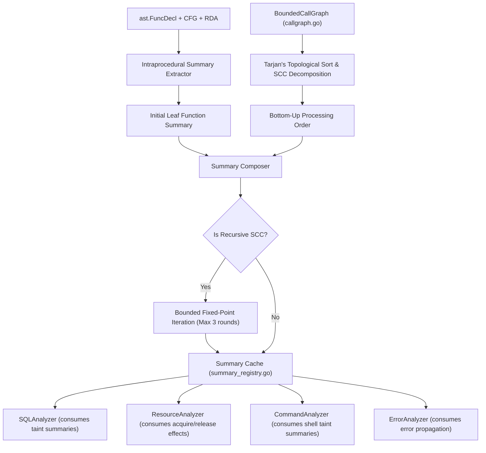

# Milestone 3.5 — Phase 1: Interprocedural Function Summary Engine Design

**Repository:** `CV-Code-Vitals/Thermodynamic-Evolution-UCS503`  
**Workspace:** `E:\SWE`  
**Branch:** `research/milestone-3.5-interprocedural-semantics`  
**Classification:** Interprocedural Static Analysis / Summary-Based Dataflow Engine  
**Status:** COMPLETE / SPECIFICATION LOCKED

---

## 1. Architectural Philosophy

Milestone 3.4 established that whole-program symbolic execution and unrestricted interprocedural inlining are computationally intractable and fragile on large codebases.

Milestone 3.5 introduces a **Compositional, Summary-Based Interprocedural Engine**:
1. **Separation of Concerns:** Each function is analyzed intraprocedurally once to produce a compact, conservative `FunctionSummary`.
2. **Bottom-Up Composition:** Call-graph topological ordering analyzes callees prior to callers, composing summaries up the call chain.
3. **Fixed-Point Convergence:** Strongly connected components (SCCs) representing recursive call cycles iterate to a bounded fixed-point (maximum 3 iterations).
4. **Conservative Merging:** Ambiguous dynamic dispatch or multi-target interface calls merge candidate summaries conservatively.

---

## 2. Core Data Structures

### 2.1 `SemanticEffectType`
Formal classification of dataflow and resource actions across call boundaries:
- `TAINT_PASSTHROUGH`: Direct return or passthrough of parameter without alteration.
- `TAINT_TRANSFORM`: Parameter is formatted, concatenated, or transformed into return string.
- `TAINT_SANITIZE_VERIFIED`: Parameter underwent verified, context-appropriate sanitization.
- `RESOURCE_ACQUIRE`: Function returns a newly acquired system resource handle.
- `RESOURCE_RELEASE`: Function closes or releases a resource handle passed via parameter.
- `RESOURCE_TRANSFER`: Function transfers ownership of a resource to caller or callee.
- `ERROR_RETURN`: Function returns an error value under specific conditions.
- `ERROR_PROPAGATE`: Function wraps or propagates an incoming error.
- `EFFECT_UNKNOWN`: Indeterminate side-effect or unresolved external call.

### 2.2 `ParameterReturnFlow`
Captures taint and dataflow propagation between input parameters and return tuples:
```go
type ParameterReturnFlow struct {
    ParamIndex  int                `json:"param_index"`
    ReturnIndex int                `json:"return_index"`
    Effect      SemanticEffectType `json:"effect"`
    TaintDomain string             `json:"taint_domain"` // "SQL", "SHELL", "RAW"
    Confidence  float64            `json:"confidence"`
    Evidence    string             `json:"evidence"`
}
```

### 2.3 `ResourceSummaryEffect`
Captures resource lifecycle transitions across function boundaries:
```go
type ResourceSummaryEffect struct {
    Effect       SemanticEffectType `json:"effect"`
    ResourceKind ResourceKind       `json:"resource_kind"`
    ParamIndex   int                `json:"param_index"`  // -1 if acquired/returned
    ReturnIndex  int                `json:"return_index"` // -1 if passed as parameter
    Condition    string             `json:"condition"`
    Evidence     string             `json:"evidence"`
}
```

### 2.4 `FunctionSummary`
Canonical summary contract associated with each function or method:
```go
type FunctionSummary struct {
    PackageName         string                  `json:"package_name"`
    PackagePath         string                  `json:"package_path"`
    FunctionName        string                  `json:"function_name"`
    ReceiverType        string                  `json:"receiver_type,omitempty"`
    ParamCount          int                     `json:"param_count"`
    ReturnCount         int                     `json:"return_count"`
    ParamReturnFlows    []ParameterReturnFlow   `json:"param_return_flows"`
    ResourceEffects     []ResourceSummaryEffect `json:"resource_effects"`
    ProducesError       bool                    `json:"produces_error"`
    ErrorReturnIndex    int                     `json:"error_return_index"`
    IsComplete          bool                    `json:"is_complete"`
    Confidence          float64                 `json:"confidence"`
    SourceHash          string                  `json:"source_hash"`
    AnalysisDurationUs  int64                   `json:"analysis_duration_us"`
    IterationCount      int                     `json:"iteration_count"`
}
```

---

## 3. Extraction & Composition Pipeline



---

## 4. Cache Invalidation & Soundness Guarantee

To ensure incremental compilation and development safety:
1. **Source Hashing:** Each summary embeds a SHA-256 digest of the function body AST.
2. **Dependency Tracking:** If a callee's summary changes, all upstream callers in the call graph are invalidated.
3. **Budget Exhaustion Guard:** If analysis timeout or iteration limit is reached, the summary is marked `IsComplete: false` and defaults to `EFFECT_UNKNOWN` to prevent unsound false negatives.

