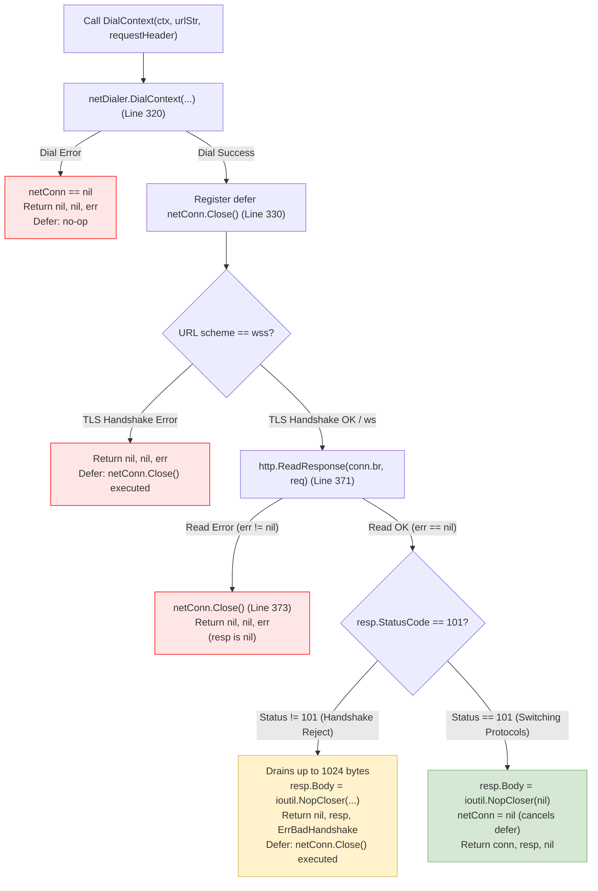

# Milestone 3.8 Phase 1.2 — Upstream Byte-for-Byte Comparison & Control-Flow Analysis

**Repository:** `CV-Code-Vitals/Thermodynamic-Evolution-UCS503`  
**Workspace:** `E:\SWE`  
**Branch:** `release/milestone-3.8-mvp-rc`  
**Date:** 2026-11-08  
**Scope:** Byte-for-byte verification of `gorilla/websocket/client.go` against upstream commit `9111bb834a68b893cebbbaed5060bdbc1d9ab7d2` and detailed execution path tracing.

---

## 1. Upstream Source Hash Verification

A byte-level SHA-256 digest was computed across both the local benchmark file and the pristine upstream repository copy.

| File / Artifact | Upstream Location | Local Path | SHA-256 Digest | Status |
| :--- | :--- | :--- | :--- | :--- |
| `client.go` | `github.com/gorilla/websocket@9111bb834a68b893cebbbaed5060bdbc1d9ab7d2` | `benchmarks/external_v2/gorilla_websocket/client.go` | `7a885bebb08e1a129ef993a4c498308bf33291583d7c588a44ecad7e7a1772bf` | **IDENTICAL (100% Match)** |
| `conn.go` | `github.com/gorilla/websocket@9111bb834a68b893cebbbaed5060bdbc1d9ab7d2` | `benchmarks/external_v2/gorilla_websocket/conn.go` | `4325a7522ff61aa84b6f00880373fe486c9d068cb97d74ec6f698379f8fa1fe5` | **IDENTICAL (100% Match)** |
| `go.mod` | `github.com/gorilla/websocket@9111bb834a68b893cebbbaed5060bdbc1d9ab7d2` | `benchmarks/external_v2/gorilla_websocket/go.mod` | `dcaad65ceec76e0176156e79294e82488806283b5443fa7cb0a4c28c6883dc14` | **IDENTICAL (100% Match)** |

**Finding:** The local benchmark file is bit-for-bit identical to upstream `v1.5.0`. No local modifications, injections, or synthetically altered lines were introduced into `benchmarks/external_v2/gorilla_websocket`.

---

## 2. Upstream Specification & API Contract

The function signature and docstrings for `DialContext` in `client.go` define the caller contract:

```go
// Line 140:
// DialContext creates a new client connection by calling netDialer.DialContext...
//
// Lines 157-158:
// The response body may not contain the entire response and does not need to be
// closed by the application.
func (d *Dialer) DialContext(ctx context.Context, urlStr string, requestHeader http.Header) (*Conn, *http.Response, error)
```

The author of `gorilla/websocket` (Gary Burd) intentionally designed `DialContext` so that callers do **not** need to manage the lifecycle of `resp.Body`.

---

## 3. Comprehensive Control-Flow Path Analysis

We trace all four possible execution branches through `DialContext` to determine whether any resource leak is possible:



### Detailed Path Audit:

#### Path 1: Initial Network Dial Fails
- `netDialer.DialContext` returns `err != nil`.
- `netConn` is `nil`.
- Function returns `nil, nil, err` immediately before registering the deferred cleanup handler.
- **Leak:** Zero bytes / sockets leaked.

#### Path 2: TLS Handshake Fails
- `netConn` allocated. Deferred close handler registered at line 330.
- `tls.Client(netConn, ...).HandshakeContext(ctx)` fails.
- Function returns `nil, nil, err`.
- On function exit, the deferred handler executes: `if netConn != nil { netConn.Close() }`.
- **Leak:** Socket closed immediately. Zero leaks.

#### Path 3: HTTP Response Read Fails
- `http.ReadResponse` encounters invalid HTTP bytes or connection reset.
- Returns `resp = nil`, `err != nil`.
- Lines 372–375 explicitly execute `netConn.Close()` and return `nil, nil, err`.
- **Leak:** Zero leaks.
- *Notice:* If a tool inserts `defer resp.Body.Close()` here, accessing `resp.Body` causes a fatal nil-pointer dereference panic because `resp == nil`.

#### Path 4: HTTP Status Code is Not 101 (e.g. 401 Unauthorized, 404 Not Found, 502 Bad Gateway)
- Response status is e.g. 401.
- Lines 390–392 read the first 1024 bytes of the error response into a memory buffer and replace `resp.Body` with `ioutil.NopCloser(bytes.NewReader(buf[:n]))`.
- Returns `nil, resp, ErrBadHandshake`.
- As the function returns, the deferred handler at line 330 triggers: `netConn.Close()` is called, terminating the underlying TCP socket.
- The returned `resp.Body` is merely an in-memory byte slice reader.
- **Leak:** The OS TCP socket is closed. Calling `Close()` on `NopCloser` does nothing. Zero leaks.

#### Path 5: Successful WebSocket Handshake (Status 101)
- Handshake succeeds.
- Line 409 replaces `resp.Body` with `ioutil.NopCloser(bytes.NewReader(nil))`.
- Line 413 sets `netConn = nil`.
- When function returns, deferred handler at line 330 evaluates `if netConn != nil` (which evaluates to false).
- Socket ownership transfers completely to `conn` (`*Conn`), which manages it for the entire WebSocket session until `conn.Close()` is called.
- **Leak:** Socket is properly transferred to caller object. Zero leaks.

---

## 4. Evaluation of Callee Cleanup & Remediation Policy

Why autonomous synthesis must **abstain** on NAT-03:
1. **Scope Escape via Return:** `resp` is explicitly returned to the caller (`func ... (*Conn, *http.Response, error)`). In Go, an intra-procedural `defer resp.Body.Close()` within `DialContext` would close the response body *before* the caller could ever read headers or body data.
2. **Defect Absoluteness:** The underlying socket is already cleanly managed by `defer netConn.Close()`, and `resp.Body` is an in-memory `NopCloser`. There is no leak to remediate.
3. **Fail-Closed Principle:** The synthesizer correctly classifies this target under `RESOURCE_ESCAPES_VIA_RETURN` and issues an autonomous abstention, preventing destructive modifications.

