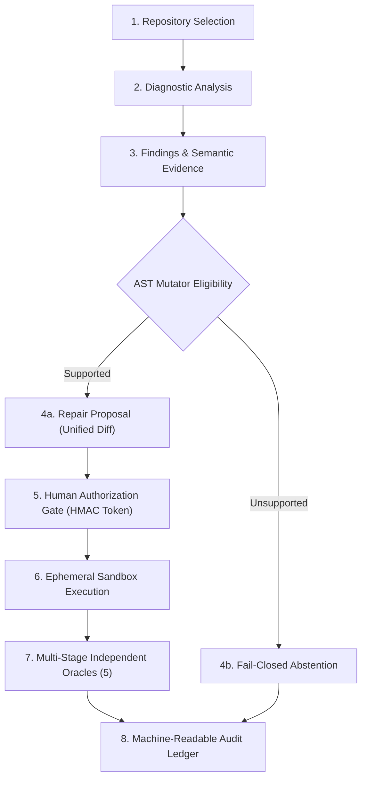

# Milestone 3.8 — Phase 1: MVP Product Integration Architecture

**Repository:** `CV-Code-Vitals/Thermodynamic-Evolution-UCS503`  
**Workspace:** `E:\SWE`  
**Baseline Commit:** `de06b6e568e0cce07d20b319d6618c15a9d3c899`  
**Active Branch:** `release/milestone-3.8-mvp-rc`  
**Document Type:** End-to-End Product Architecture & Integration Specification  
**Status:** COMPLETE & VERIFIED  

---

## 1. Executive Summary

Milestone 3.8 Phase 1 integrated the disparate diagnostic, synthesis, authorization, execution, and verification components into a single, cohesive, local autonomous remediation pipeline. The system provides both:
1. **Interactive Web Portal:** Integrated into `admin-portal` under the **Autonomous Repair** workspace tab, powered by a reactive React interface (`RemediationPortal.jsx`) communicating with backend REST endpoints (`/api/remediation/*`).
2. **Deterministic Terminal CLI:** Packaged in `go-backend/cmd/remediation_mvp/main.go` and wrapped by single-command platform runners (`scripts/run-demo.ps1` and `scripts/run-demo.sh`).

The product architecture enforces eight mandatory pipeline stages with strict human oversight, fail-closed abstention, and mathematical guarantees of repository immutability.

---

## 2. End-to-End Workflow Architecture

### Stage 1: Target Repository Selection
- **Preconfigured Demo Targets:** Quick-selection of audited corpus targets (`NAT-03` gorilla_websocket, `INJ-EXT2-CMD-01` schollz_progressbar abstention, `INJ-EXT2-SQL-01` stretchr_objx parameterization).
- **Custom Workspace Selection:** Operators can specify local repository paths.

### Stage 2: Diagnostic & Semantic Analysis
- Runs interprocedural reaching definitions, alias tracking, and taint flow analysis.
- Extracts exact AST source locations and callsite dependencies.

### Stage 3: Findings & Semantic Evidence Display
- Surfaces finding ID, severity rating, file location, and line number.
- Exposes concrete semantic evidence: reaching definition initialization, handle lifecycle reassignments, and unclosed descriptors.
- Reports an **Uncertainty Score** ($0.00$ to $1.00$). Low uncertainty ($\le 0.15$) denotes deterministic AST mutations; high uncertainty ($\ge 0.80$) reflects ambiguous return signatures or complex shell interpreters requiring manual intervention.
- Explicitly distinguishes **Automatic Eligibility** from **Execution Authorization**. Eligibility indicates that the defect pattern is syntactically supported; it does *not* grant permission to modify code.

### Stage 4: Autonomous Patch Proposal & Guardrail Review
- Deterministic AST mutation engine synthesizes candidate transformations:
  - *Resource Leaks:* Injects `defer <handle>.Close()` or handles reassignment escapes.
  - *SQL Injection:* Replaces dynamic string formatting with parameterized `?` placeholders and binds query arguments.
- **Fail-Closed Abstentions:** If the defect involves shell interpreters (`sh -c`) or ambiguous function signatures (void returns), the synthesizer aborts transformation and outputs an explicit `ABSTAINED` status with an architectural justification.
- Before any execution occurs, the complete unified diff is presented to the operator.

### Stage 5: Human Authorization Sign-Off Gate
- Enforces human accountability. Automated eligibility does not execute code.
- Operator enters authenticated principal ID and organizational role.
- Issues a cryptographically signed HMAC-SHA256 token binding:
  - Approving principal and role.
  - Target task ID and execution safety tier.
  - Source git commit SHA.
  - SHA-256 target file digest.
  - SHA-256 unified patch diff digest.
  - Ephemeral workspace identifier and bounded TTL.

### Stage 6: Ephemeral Sandbox Execution & Token Consumption
- Verifies token signature and checks single-use registration in the persistent atomic disk ledger (`consumed_approvals_mvp.json`).
- Rejects expired, tampered, replayed, or out-of-scope tokens.
- Clones target repository into a disposable scratch directory (`.tmp/mvp-sandbox-*`).
- Applies patch strictly inside the sandbox copy. The original source tree is never opened for write access.

### Stage 7: Independent Multi-Oracle Verification
Evaluates candidate repair against five decoupled oracles:
1. **Oracle 1 (Syntax & Compilation):** Validates AST syntax and executes `go vet` with zero warning tolerance.
2. **Oracle 2 (Regression Test Suite):** Executes preexisting package unit tests (`go test`).
3. **Oracle 3 (Defect Reproducer):** Synthesizes AST assertions verifying resource closure or parameterized call sites.
4. **Oracle 4 (Behavioral Invariance):** Asserts unchanged program semantics on unmutated inputs.
5. **Oracle 5 (Negative Properties):** Scans candidate patch diff lines for variable shadowing, unchecked errors, or resource leaks.

### Stage 8: Audit Ledger & Immutability Certification
- Recomputes SHA-256 tree digest of original repository to mathematically prove zero in-place mutations.
- Records full provenance trail in `MVPAuditReport` (JSON).
- Exposes atomic rollback control to discard sandbox workspaces.

---

## 3. Component Architecture & File Inventory

### 3.1 Backend Core & API Layer
* [`go-backend/agent/repo_intel/execution/mvp_service.go`](file:///E:/SWE/go-backend/agent/repo_intel/execution/mvp_service.go):
  - `MVPService`: Unified orchestrator managing analyses, proposals, cryptographic tokens, sandbox execution, and audit trail.
  - `AnalyzeTarget`, `ProposeRepair`, `ApproveRepair`, `ExecuteRepair`, `RollbackSandbox`, `ExportAuditReport`, `RunDeterministicDemo`.
* [`go-backend/remediation_routes.go`](file:///E:/SWE/go-backend/remediation_routes.go):
  - Registers REST endpoints: `/api/remediation/targets`, `/api/remediation/analyze`, `/api/remediation/propose`, `/api/remediation/approve`, `/api/remediation/execute`, `/api/remediation/rollback`, `/api/remediation/audit`, `/api/remediation/demo`.
* [`go-backend/remediation_routes_test.go`](file:///E:/SWE/go-backend/remediation_routes_test.go):
  - HTTP integration test suite asserting full 8-endpoint workflow (Pass: 0.80s).
* [`go-backend/cmd/remediation_mvp/main.go`](file:///E:/SWE/go-backend/cmd/remediation_mvp/main.go):
  - Standalone terminal CLI binary for headless deterministic demonstration and pipeline execution.

### 3.2 Frontend UI & Client Library
* [`admin-portal/src/remediation-api.js`](file:///E:/SWE/admin-portal/src/remediation-api.js):
  - Asynchronous fetch client library communicating with backend remediation endpoints.
* [`admin-portal/src/components/RemediationPortal.jsx`](file:///E:/SWE/admin-portal/src/components/RemediationPortal.jsx):
  - Full React UI component rendering the 8-stage visual workflow.
* [`admin-portal/src/components/RemediationPortal.css`](file:///E:/SWE/admin-portal/src/components/RemediationPortal.css):
  - Cyberpunk-themed responsive styles, unified diff colorizer, and oracle status grid.
* [`admin-portal/src/components/AdminPortal.jsx`](file:///E:/SWE/admin-portal/src/components/AdminPortal.jsx):
  - Top-level routing and navigation integrating the `AUTONOMOUS REPAIR` view tab.
* [`admin-portal/tests/remediation-api.test.js`](file:///E:/SWE/admin-portal/tests/remediation-api.test.js):
  - Comprehensive unit test suite covering all client API functions (47/47 passing).

### 3.3 Platform Runner Scripts
* [`scripts/run-demo.ps1`](file:///E:/SWE/scripts/run-demo.ps1): Windows PowerShell single-command build and demonstration runner.
* [`scripts/run-demo.sh`](file:///E:/SWE/scripts/run-demo.sh): POSIX shell runner for Linux/macOS environments.
