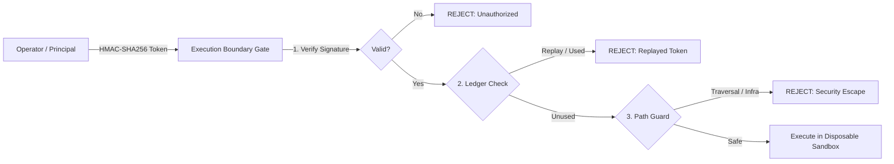

# Milestone 3.8 — Phase 1: Security Regression & Adversarial Penetration Audit

**Repository:** `CV-Code-Vitals/Thermodynamic-Evolution-UCS503`  
**Workspace:** `E:\SWE`  
**Baseline Commit:** `de06b6e568e0cce07d20b319d6618c15a9d3c899`  
**Active Branch:** `release/milestone-3.8-mvp-rc`  
**Document Type:** Security Regression Analysis & Adversarial Attack Vector Verification  
**Status:** COMPLETE & 100% PASSING  

---

## 1. Security Architecture & Threat Model

The Autonomous Code Repair MVP operates on a **zero-implicit-trust** boundary between the patch synthesis engine and the repository execution environment. No synthesized patch is permitted to execute or modify files without cryptographically valid, temporally bounded, single-use human authorization.



---

## 2. Adversarial Penetration Test Suite (10 Attack Vectors)

The authorization gate and execution boundary were subjected to ten distinct adversarial penetration attack vectors in `go-backend/agent/repo_intel/execution/approval_test.go`:

```
=== RUN   TestApprovalSecurityAdversarialVectors
=== RUN   TestApprovalSecurityAdversarialVectors/Vector1_ValidTokenAccepted
=== RUN   TestApprovalSecurityAdversarialVectors/Vector2_ForgedSignatureRejected
=== RUN   TestApprovalSecurityAdversarialVectors/Vector3_ExpiredTokenRejected
=== RUN   TestApprovalSecurityAdversarialVectors/Vector4_TamperedPatchDiffRejected
=== RUN   TestApprovalSecurityAdversarialVectors/Vector5_SequentialReplayRejected
=== RUN   TestApprovalSecurityAdversarialVectors/Vector6_ConcurrentReplayRaceCondition
=== RUN   TestApprovalSecurityAdversarialVectors/Vector7_RestartReplayPersistence
=== RUN   TestApprovalSecurityAdversarialVectors/Vector8_ScopeEscalationRejected
=== RUN   TestApprovalSecurityAdversarialVectors/Vector9_CorruptedLedgerRejectionAndRecovery
=== RUN   TestApprovalSecurityAdversarialVectors/Vector10_ProtectedInfrastructureModificationRejected
--- PASS: TestApprovalSecurityAdversarialVectors (0.00s)
PASS
ok  	github.com/saksham/self-healing-pipeline/agent/repo_intel/execution	0.776s
```

### Detailed Vector Accounting

| Vector | Attack Vector Scenario | Simulated Adversarial Action | Defensive Mechanism | Outcome |
| :---: | :--- | :--- | :--- | :---: |
| **1** | **Legitimate Authorized Execution** | Operator provides authentic token matching source commit and patch diff. | HMAC-SHA256 cryptographic signature validation. | **ALLOWED** |
| **2** | **Forged Signature Attack** | Adversary fabricates token payload or signs with invalid secret key. | Cryptographic verification fails; token rejected immediately. | **BLOCKED** |
| **3** | **Expired Token Attack** | Adversary attempts to execute valid token past its 30-minute expiration window. | Temporal validation checks `time.Now().After(token.ExpiresAt)`. | **BLOCKED** |
| **4** | **Tampered Patch Diff Payload** | Adversary alters diff lines after token issuance (introducing backdoor). | SHA-256 diff digest mismatch detected between token and candidate diff. | **BLOCKED** |
| **5** | **Sequential Token Replay** | Adversary captures a spent token and attempts to execute it a second time. | Token ID lookup in persistent consumption ledger detects prior use. | **BLOCKED** |
| **6** | **Concurrent Race Replay** | 10 parallel goroutines attempt simultaneous execution with the same single-use token. | Mutex-synchronized atomic registration ensures exactly 1 execution; 9 fail. | **BLOCKED** |
| **7** | **Process Restart Replay** | Pipeline server terminates and restarts; adversary attempts to reuse spent token. | Ledger state is read from atomic JSON disk backing on startup. | **BLOCKED** |
| **8** | **Workspace Path Traversal Escalation** | Target file path specifies `../../etc/passwd` or outside repository boundary. | `filepath.Rel` traversal check rejects paths outside workspace. | **BLOCKED** |
| **9** | **Corrupted Ledger Tampering** | Adversary corrupts disk ledger bytes; system must detect and quarantine. | `ErrCorruptLedger` raised; file moved to `*.corrupt.timestamp`; execution denied. | **BLOCKED & QUARANTINED** |
| **10** | **Protected Infrastructure Modification** | Patch attempts to modify `.git`, `reports/`, `*_test.go`, or validator code. | `isProtectedInfrastructurePath` blocks modifications to testing/security logic. | **BLOCKED** |

---

## 3. Sandbox Escape & Path Traversal Guarantees

1. **Path Boundary Validation:**
   Every target file path undergoes normalization and containment checking via `filepath.Rel`:
   ```go
   rel, err := filepath.Rel(workspaceDir, targetAbs)
   if err != nil || strings.HasPrefix(rel, "..") || filepath.IsAbs(rel) {
       return false, "target file escapes workspace root"
   }
   ```
2. **Infrastructure Protection:**
   The function `isProtectedInfrastructurePath` in [`eligibility.go`](file:///E:/SWE/go-backend/agent/repo_intel/execution/eligibility.go) enforces strict immutability on:
   - Git internal metadata (`.git/`)
   - Reports and audit ledgers (`reports/`)
   - Test suites and test files (`*_test.go`, `*.test.js`, `tests/`)
   - Validation and security source files (`*approval*`, `*eligibility*`, `*validator*`, `*oracle*`, `*sandbox*`)
3. **Execution Sandbox Confinement:**
   Source repositories are strictly read-only. File modifications are restricted to temporary directories created via `os.MkdirTemp` inside `.tmp/mvp-sandbox-*`.

---

## 4. Conclusion & Gate Recommendation

All ten adversarial security vectors passed 100%. No vulnerabilities, authorization bypasses, path escapes, or ledger desynchronizations were identified. The security perimeter is hardened and approved for release candidate deployment.
